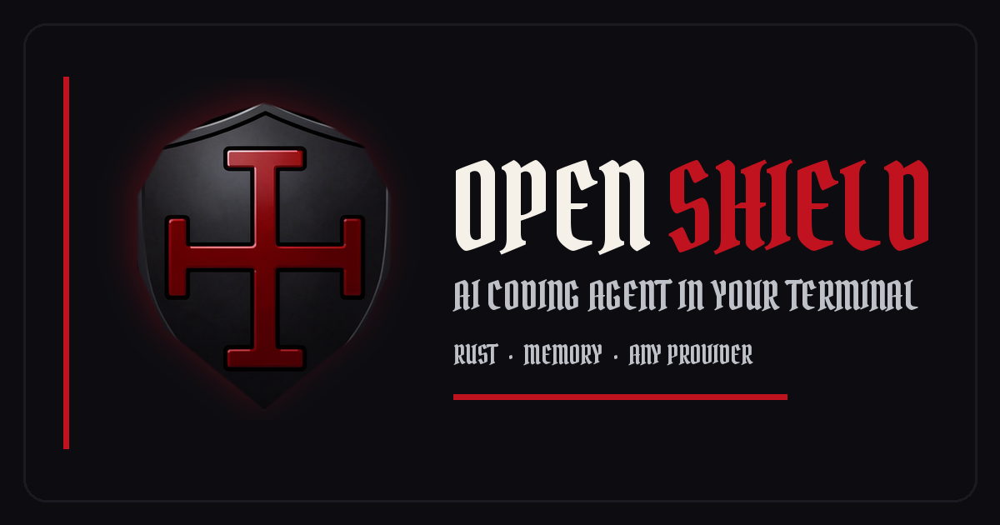

# OpenShield

AI coding agent in your terminal. Rust. Open source. Blackshield by default.



[](https://github.com/Blackshield-Company/openshield/releases)
[](https://github.com/Blackshield-Company/openshield/actions/workflows/ci.yml)
[](LICENSE)
[](https://rust-lang.org)

## What It Does

- **Persistent memory** — SQLite-backed sessions with keyword and semantic search. Close the terminal, come back next week, it still knows what you were doing.
- **Any model provider** — Works with any OpenAI-compatible API. OpenRouter, llama-swap, xAI, local servers. Not locked to anyone.
- **Autonomous agent mode** — Plans, executes, verifies, retries. You approve the plan, it does the work.
- **Blackshield TUI** — Blood, steel, bone, and void palette with the Blackshield Mercenary shield on launch.

## Install

```bash
curl -fsSL https://raw.githubusercontent.com/Blackshield-Company/openshield/main/install.sh | bash
```

Downloads the prebuilt binary for your platform (Linux x86_64/aarch64, macOS x86_64/arm64) from [GitHub Releases](https://github.com/Blackshield-Company/openshield/releases), verifies its SHA-256 checksum, and installs it to `~/.local/bin/openshield`. If no prebuilt binary matches, it falls back to `cargo install --git`.

Options: `OPENSHIELD_VERSION=v1.1.0` pins a release, `BIN_DIR=/path` changes the install directory, `OPENSHIELD_FROM_SOURCE=1` forces a source build, `DRY_RUN=1` prints the plan without installing.

Windows: download `openshield-x86_64-pc-windows-msvc.zip` from the releases page. From source anywhere: `cargo install --git https://github.com/Blackshield-Company/openshield --locked`.

## First Run

```bash
openshield setup    # Configure providers and models
openshield          # Start TUI session
```

For cloud models, set one API key environment variable before starting: `OPENAI_API_KEY`, `ANTHROPIC_API_KEY`, `KIMI_API_KEY`, or `XAI_API_KEY`. To run fully local with no API key, see [Local models (Ollama, llama.cpp)](#local-models-ollama-llamacpp).

## Local models (Ollama, llama.cpp)

OpenShield talks to any OpenAI-compatible server, so it can run fully local with no cloud API key. Ollama, llama.cpp `llama-server` and llama-swap all work.

**Context size matters.** The system prompt alone is about 5k tokens, and Ollama defaults to a 4096-token context. Give the model at least 16k:

```bash
printf 'FROM qwen2.5:7b\nPARAMETER num_ctx 16384\n' > Modelfile   # or FROM /path/to/model.gguf
ollama create qwen-local -f Modelfile
```

If the context is too small, OpenShield reports `Context window exceeded` and exits non-zero.

In `~/.config/openshield/config.toml`, keep the generated non-provider sections, replace the `[providers.*]` tables, and set `default_model`:

```toml
default_model = "qwen-local"

[providers.ollama]
base_url = "http://127.0.0.1:11434/v1"
api_key = "ollama"            # any non-empty dummy value; no env var needed

[[providers.ollama.models]]
name = "qwen-local"
context_length = 32768
cost_per_1k_input = 0.0
cost_per_1k_output = 0.0
capabilities = ["code", "chat"]
```

Then:

```bash
openshield models                   # qwen-local [default]
openshield chat "What is 2+2?"
openshield agent "summarize src/"   # uses default_model; override with --model
openshield headless -m qwen-local "..."
```

For llama.cpp `llama-server` or llama-swap, use the same layout with `base_url = "http://127.0.0.1:8080/v1"`. The model names must match what the server serves. The built-in `local` provider written by `openshield setup` uses example model names (`local-35b-128k`, ...), so edit them to match your server. Very small models (under ~3B parameters) work for chat but often choose bad tools in agent mode.

## Commands

| Command | Description |
|---------|-------------|
| `openshield` | Start TUI session |
| `openshield setup` | Configure providers, models, preferences |
| `openshield agent "<task>"` | Execute task autonomously |
| `openshield chat "<message>"` | One-shot chat |
| `openshield memory <query>` | Search persistent memory |
| `openshield memory <query> --semantic` | Semantic memory search |
| `openshield stats` | Token usage and model performance |
| `openshield models` | List available models |
| `openshield config` | Show configuration |
| `openshield serve` | Desktop/Pocket API. Bearer token required on every request, including loopback (`~/.config/openshield/desktop.token`; WebSocket may use `?token=`) |

## TUI Keybindings

| Key | Action |
|-----|--------|
| `Ctrl+A` | Toggle autonomous mode |
| `Ctrl+T` | Cycle themes |
| `/multi` | Toggle multi-model mode |
| `/compare` | Show multi-model comparison |
| `↑/↓` | Navigate history |

Themes: `blackshield` (default), `steel_blue`, `high_contrast`.

## Tools

9 built-in tools: `edit`, `fs`, `git`, `lsp`, `refactor`, `search`, `grep`, `terminal`, `test`. Plus MCP server tools via native client.

## Config

Config lives at `~/.config/openshield/config.toml`. Run `openshield setup` for interactive generation.

<details>
<summary>Example config</summary>

```toml
version = "1.1.0"
default_model = "gpt-4o"
auto_route = true
cost_limit_usd = 10.0
theme = "blackshield"
# Mascot sprite on the splash screen ("none" disables it).
# Custom sprites: ~/.config/openshield/sprites/*.ans|*.txt
sprite = "blackshield-mercenary"

[providers.openai]
base_url = "https://api.openai.com/v1"
api_key = "${OPENAI_API_KEY}"

[[providers.openai.models]]
name = "gpt-4o"
context_length = 128000
cost_per_1k_input = 0.005
cost_per_1k_output = 0.015
capabilities = ["code", "chat", "analysis"]
```

</details>

## File locations

Linux and macOS follow the XDG Base Directory spec. A relative `XDG_*_HOME` is ignored. Windows keeps the standard per-user config, data, and cache folders.

| | Unix default | Override |
|---|---|---|
| Config | `~/.config/openshield` | `$XDG_CONFIG_HOME/openshield` |
| Data | `~/.local/share/openshield` | `$XDG_DATA_HOME/openshield` |
| Cache | `~/.cache/openshield` | `$XDG_CACHE_HOME/openshield` |

The desktop token defaults to `~/.config/openshield/desktop.token` (resolved against the config dir at runtime). `memory.db` and `sessions/` live in the data dir; the response cache lives in the cache dir.

On macOS, files previously under `~/Library/Application Support/openshield` and `~/Library/Caches/openshield` are moved on first launch. The old path is left as a symlink (or a `MOVED_TO_XDG.txt` note if the symlink cannot be created).

## Development

```bash
git clone https://github.com/Blackshield-Company/openshield
cd openshield
cargo build --release
cargo test
```

The release profile uses fat LTO, and its link step can need more than 15 GB of RAM. On smaller machines, turn LTO off for a local build (the binary is slightly larger and slower; the shipped profile is unchanged):

```bash
CARGO_PROFILE_RELEASE_LTO=false cargo build --release -j4
```

## More

- [CHANGELOG.md](CHANGELOG.md) — Version history
- [ROADMAP.md](ROADMAP.md) — Future plans
- [STATUS.md](STATUS.md) — Current development status

## License

Apache License 2.0. See [LICENSE](LICENSE).

Security issues: see [SECURITY.md](SECURITY.md).

---

## ☕ Support the Developer

If this project saved you time, solved a problem, or kept your terminal a little more steel-forged, you can fuel the next one:

[](https://buymeacoffee.com/synthalorian)

## Demo: web terminal + mock provider (no API keys)

```bash
cargo run --release -- demo                 # open http://127.0.0.1:7681
cargo run --release -- demo --bind 0.0.0.0 --port 8080
cargo run --release -- mock-provider        # mock OpenAI-compatible API only, http://127.0.0.1:7682/v1
```

`openshield demo` starts a built-in mock model (canned replies, no network), writes an
isolated config whose only provider is that mock, and serves a browser terminal
(xterm.js over WebSocket) running the full TUI. Your own `~/.config/openshield` is not used.

| Env var | Default | Purpose |
|---|---|---|
| `OPENSHIELD_DEMO_PORT` | `7681` | Web terminal port (`--port` overrides) |
| `OPENSHIELD_DEMO_BIND` | `127.0.0.1` | Bind address (`--bind` overrides) |
| `OPENSHIELD_DEMO_DIR` | `$TMPDIR/openshield-demo` | Isolated config/data/workspace dir |
| `OPENSHIELD_MOCK_PORT` | `7682` | Port for `mock-provider` |

The web terminal has no authentication and gives a shell-capable agent session, so only
expose it beyond loopback on a sandboxed host.
