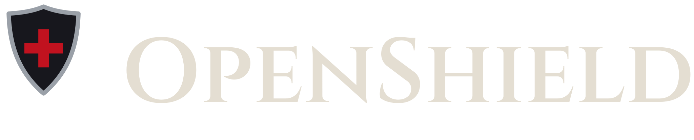

# OpenShield brand: Black Steel

The single source of truth for the OpenShield mark, wordmark, colors and type,
shared by `openshield`, `openshield-desktop`, `openshield-extension` and
`openshield-mobile`. Part of the Blackshield Company identity: a black heater
shield with a steel rim and a plain red Greek cross.

## Files

| File | Use |
|---|---|
| `shield.svg` | Master mark. Flat: steel rim, iron field, plain blood-red Greek cross. |
| `shield-mono.svg` | One-color mark (`currentColor`) for monochrome icons, favicons in tinted UIs, print. |
| `shield-tile.svg` | App-icon tile (rounded iron square + mark). Source for desktop, mobile and extension icons. |
| `wordmark.svg` | "OpenShield" in Cinzel SemiBold, converted to outlines (no font needed to display it). |
| `lockup.svg` | Mark + wordmark, horizontal. |
| `icons/` | Prebuilt PNGs: `tile-{16,32,48,128,512}.png`, `shield-{16,512}.png`. |
| `tokens.css` / `tokens.json` | Color, type and radius tokens. |
| `hero/` | HTML source of the 1280×640 README / social preview image. Render with a headless browser at 1280×640. |

## Mark rules

- Use the plain Greek cross only (equal arms). No Latin, potent, or glowing variants.
- Keep the mark flat: no bevels, textures, glows or lava veins.
- Minimum size 16 px. Below 32 px prefer `shield.svg` over the tile.
- Clear space around the mark: at least the width of one cross arm.

## Palette

| Token | Hex | Role |
|---|---|---|
| `void` | `#0E0E12` | Page / app background |
| `iron` | `#17171D` | Panels, rails, shield field |
| `plate` | `#22222A` | Raised surfaces, hover |
| `edge` | `#34343F` | Borders, dividers |
| `steel` | `#9AA0A8` | Shield rim, secondary text, icons |
| `text-muted` | `#C3C7CC` | Body text on dark |
| `bone` | `#E4DED2` | Primary text, wordmark |
| `blood` | `#C1121F` | Accent: primary action, focus, the cross |
| `blood-hi` | `#E0303C` | Accent hover / on very dark |
| `ember` | `#D4A72C` | Warning |
| `moss` | `#5E9E5A` | Success |

Red is an accent, not a fill: primary buttons, focus rings, active states and
the cross. Body text is `text-muted` or `bone`, never `steel` on `void` for
long copy.

## Type

| Role | Family | Notes |
|---|---|---|
| Display | Cinzel SemiBold | Wordmark and H1 only. Small caps feel; never for body text. |
| UI | Inter | App chrome, docs, READMEs. |
| Mono | JetBrains Mono | Code, terminals, paths, tokens. |

Fallback stacks are in `tokens.css`. See [FONTS.md](FONTS.md) for licensing.
